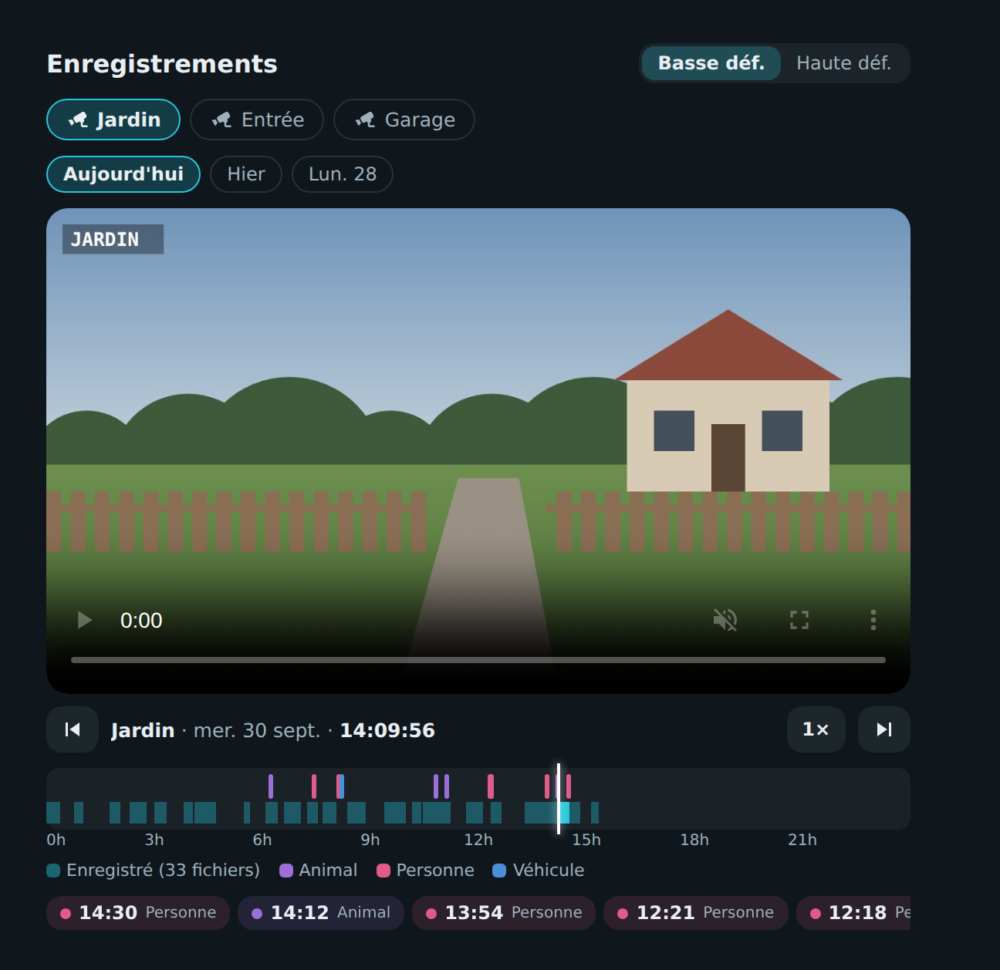

# 🎥 HOLM Recordings Card

[](https://hacs.xyz/)


**Les enregistrements de vos caméras Reolink directement dans Home Assistant : une caméra, un jour, une frise de 24 h avec les détections, et la lecture s'enchaîne toute seule.**

HOLM Recordings Card lit la **source multimédia Reolink** de Home Assistant (NVR, Home Hub ou caméras avec carte SD). Plus besoin d'ouvrir l'application Reolink pour retrouver le passage du facteur : on touche la frise ou une détection et la vidéo démarre au bon moment.

> ✨ **Aucune configuration nécessaire** : les caméras et les jours sont trouvés automatiquement. L'éditeur visuel permet de renommer, masquer ou ajouter des détections à chaque caméra.

### En bref

- 📹 **Caméras et jours** en pastilles : Aujourd'hui, Hier, Lun. 28…
- 🕒 **Frise 24 h** : les plages enregistrées, le curseur de lecture, l'heure au survol ; un toucher lit l'instant choisi.
- 🚶 **Détections** : personnes, véhicules, animaux, mouvements (vos `binary_sensor`) placés sur la frise en couleur et listés sous forme de raccourcis.
- ⏭️ **Lecture continue** : à la fin d'un fichier, le suivant démarre ; boutons clip précédent / suivant.
- ⏩ Vitesse 1× · 2× · 4× · 8×, bascule **basse / haute définition** en gardant la position.



---

## Installation

### Avec HACS (recommandé)

1. HACS → menu ⋮ → **Dépôts personnalisés**.
2. Ajoutez `https://github.com/kaaribou/holm-recordings-card`, catégorie **Tableau de bord** (*Dashboard / Plugin*).
3. Recherchez la carte → **Télécharger**.
4. Rechargez la page (Ctrl + F5).

### Manuellement

1. Copiez `dist/holm-recordings-card.js` dans `config/www/community/holm-recordings-card/`.
2. **Paramètres → Tableaux de bord → ⋮ → Ressources → Ajouter** : `/local/community/holm-recordings-card/holm-recordings-card.js`, type **Module JavaScript**.
3. Rechargez la page.

---

## Prérequis

- L'intégration **Reolink** de Home Assistant, avec des enregistrements sur le NVR, le Home Hub ou la carte SD de la caméra.
- Les enregistrements apparaissent dans **Médias → Reolink** : si c'est le cas, la carte les voit aussi.

## Utilisation

```yaml
type: custom:holm-recordings-card
title: Enregistrements
resolution: sub
cameras:
  - title: Jardin           # nom de la caméra dans Reolink
    name: Jardin
    events:
      - binary_sensor.jardin_personne
      - binary_sensor.jardin_vehicule
  - title: Garage
    hide: true
```

## Options

| Option | Description | Par défaut |
|---|---|---|
| `title` | Titre | `Enregistrements` |
| `resolution` | `sub` (basse définition, rapide) ou `main` (haute définition) | `sub` |
| `cameras` | Réglages par caméra (facultatif) : ordre, nom, détections, masquage | toutes |

Chaque caméra accepte :

| Clé | Description |
|---|---|
| `title` | Nom de la caméra dans Reolink (**obligatoire**) |
| `name` | Nom affiché |
| `events` | Capteurs de détection (`binary_sensor`) à placer sur la frise |
| `hide` | Masquer la caméra |

La couleur d'une détection dépend du nom du capteur : personne (rose), véhicule (bleu), animal (violet), sinon mouvement (ambre).

## FAQ

| Problème | Solution |
|---|---|
| « Source Reolink introuvable » | Vérifiez que l'intégration Reolink est installée et que **Médias → Reolink** affiche des enregistrements. |
| La lecture est lente à démarrer | Restez en **basse définition** ; la haute définition charge des fichiers bien plus lourds. |
| La nouvelle version ne s'affiche pas | Videz le cache (Ctrl + F5). |

> [!NOTE]
> Carte indépendante, sans lien avec la société Reolink. L'image d'illustration est un dessin de démonstration.

---

## Un petit merci ?

La carte vous plaît ? Vous pouvez m'offrir une bière 🍺

[](https://paypal.me/kaaribou)

---

## Licence

Code : licence **MIT** — © kaaribou. Voir le [CHANGELOG](CHANGELOG.md).

Fait partie de la collection **HOLM** : [Carburant HOLM](https://github.com/kaaribou/carburant-holm) · [HOLM Navbar Card](https://github.com/kaaribou/holm-navbar-card) · [HOLM Music Card](https://github.com/kaaribou/holm-music-card) · [HOLM Sentinel Card](https://github.com/kaaribou/holm-sentinel-card).
